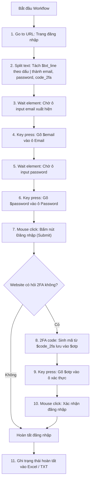

# 📚 GPM Automate: Quản lý Biến, Ánh xạ Dữ liệu Excel & TXT, Tách Chuỗi và Tự động hóa

Tài liệu này cung cấp hướng dẫn toàn diện từ cơ bản đến nâng cao để xử lý dữ liệu đầu vào (Excel, file văn bản TXT), tự động trích xuất thông tin tài khoản dạng `user|pass|2fa|url` bằng action **Split text**, tạo mã bảo mật 2 lớp **2FA TOTP**, và điền vào các trang web mục tiêu.

---

## 📑 Mục lục

1. [Tổng quan về Biến trong GPM Automate](#1-tổng-quan-về-biến-trong-gpm-automate)
2. [Ánh xạ Dữ liệu từ File Excel (`$col_A`, `$col_B`...)](#2-ánh-xạ-dữ-liệu-từ-file-excel-col_a-col_b)
3. [Đọc Dữ liệu từ File Text (`$txt_line`, `$line_1`...)](#3-đọc-dữ-liệu-từ-file-text-txt_line-line_1)
4. [Tách Chuỗi Dữ liệu bằng Action `Split text` (Type 9)](#4-tách-chuỗi-dữ-liệu-bằng-action-split-text-type-9)
5. [Tạo Mã Xác thực 2 Lớp với Action `2FA code` (Type 81)](#5-tạo-mã-xác-thực-2-lớp-với-action-2fa-code-type-81)
6. [Nhập Biến vào Web với Action `Key press` (Type 54)](#6-nhập-biến-vào-web-với-action-key-press-type-54)
7. [Quy trình Mẫu Hoàn chỉnh (End-to-End Workflow)](#7-quy-trình-mẫu-hoàn-chỉnh-end-to-end-workflow)
8. [Bảng Tra cứu Biến Hệ thống (Quick Reference)](#8-bảng-tra-cứu-biến-hệ-thống-quick-reference)

---

## 1. Tổng quan về Biến trong GPM Automate

### 1.1. Cú pháp gọi biến
Trong bất kỳ trường dữ liệu nào (URL, XPath, Giá trị gõ phím, Thời gian chờ, Nội dung tin nhắn), bạn có thể gọi giá trị của biến theo các cú pháp chuẩn:

- **Dạng ngắn gọn:** `$tên_biến` (Ví dụ: `$col_A`, `$email`, `$password`, `$code_2fa`)
- **Dạng có dấu ngoặc:** `${tên_biến}` hoặc `{{tên_biến}}`

> **Mẹo gõ nhanh:** Trong giao diện soạn thảo workflow, chỉ cần gõ ký tự `$` vào bất kỳ ô nhập liệu nào, hệ thống sẽ tự động hiển thị danh sách gợi ý biến kèm nhãn danh mục (Excel, TXT, Data, System, Custom).

### 1.2. Thẻ "Variables" ở thanh công cụ bên trái
Bên cạnh danh sách **Actions**, bạn có thể chuyển qua tab **Variables** để:
- Xem toàn bộ các biến có sẵn trong hệ thống theo từng nhóm.
- Tìm kiếm biến nhanh chóng.
- Nhấp chuột vào bất kỳ biến nào để tự động copy `$tên_biến` vào bộ nhớ tạm (Clipboard).

---

## 2. Ánh xạ Dữ liệu từ File Excel (`$col_A`, `$col_B`...)

Khi chạy tự động hóa hàng loạt profile với file Excel, hệ thống sẽ tự động đọc từng dòng tương ứng và nạp vào các biến sau:

### 2.1. Danh sách biến được tạo tự động từ Excel

| Biến | Ý nghĩa | Ví dụ giá trị |
| :--- | :--- | :--- |
| `$col_A` (hoặc `$A`) | Dữ liệu ở Cột A của dòng hiện tại | `testuser@gmail.com` |
| `$col_B` (hoặc `$B`) | Dữ liệu ở Cột B của dòng hiện tại | `Password@123` |
| `$col_C` (hoặc `$C`) | Dữ liệu ở Cột C của dòng hiện tại | `JBSWY3DPEHPK3PXP` (Mã bí mật 2FA) |
| `$col_D` (hoặc `$D`) | Dữ liệu ở Cột D của dòng hiện tại | `https://example.com/login` |
| `$col_E` ... `$col_Z` | Các cột tiếp theo | Tương ứng dữ liệu cột |
| `$excel_row` | Số thứ tự dòng Excel đang thực thi | `2`, `3`, `4`... |
| `$tên_tiêu_đề` | Nếu dòng 1 là tiêu đề (Header), biến sẽ lấy theo tên tiêu đề | `$email`, `$proxy`, `$status` |

### 2.2. Cấu hình tại Bước 2 (Configure)
1. Tích chọn **`[x] Use input Excel`**.
2. Nhấn **`Browse...`** để chọn file `.xlsx` hoặc `.csv`.
3. Nhập **`Sheet Id`** (mặc định là `0` cho sheet đầu tiên).
4. Chọn chế độ Map:
   - **Each profile reads all rows**: Mỗi profile lặp qua tất cả các dòng.
   - **Each profile reads one row**: Mỗi profile xử lý 1 dòng tương ứng với thứ tự của nó.
5. **Map according to column A**: Khớp dòng theo tên Profile ở cột A.
6. **Write 'OK' upon completion**: Tự động ghi chữ `OK` vào cột bạn chọn (ví dụ cột `Z`) khi profile chạy xong.
7. **Bỏ qua nếu cột trạng thái đã có chữ**: Nếu cột `Z` đã có chữ hoặc chứa từ khóa `done, trạng thái:, error`, profile đó sẽ được **tự động bỏ qua** (không bật trình duyệt, tiết kiệm tối đa CPU/RAM).

---

## 3. Đọc Dữ liệu từ File Text (`$txt_line`, `$line_1`...)

Nếu dữ liệu đầu vào của bạn lưu dưới dạng file text (.txt), mỗi dòng là một tài khoản:

### 3.1. Danh sách biến tạo tự động từ file TXT

| Biến | Ý nghĩa | Ví dụ giá trị |
| :--- | :--- | :--- |
| `$txt_line` (hoặc `$line`) | Nguyên văn toàn bộ dòng text được cấp cho profile | `user1|pass123|JBSWY3DPEHPK3PXP|https://site.com` |
| `$line_1` (hoặc `$col_1`) | Phần tử thứ 1 (nếu file TXT phân cách bởi dấu `\|`, tab hoặc `,`) | `user1` |
| `$line_2` (hoặc `$col_2`) | Phần tử thứ 2 | `pass123` |
| `$line_3` (hoặc `$col_3`) | Phần tử thứ 3 | `JBSWY3DPEHPK3PXP` |
| `$line_4` (hoặc `$col_4`) | Phần tử thứ 4 | `https://site.com` |

---

## 4. Tách Chuỗi Dữ liệu bằng Action `Split text` (Type 9)

Khi dòng text có cấu trúc phân cách bằng ký tự `|` (ví dụ: `email|password|twofa_secret|link_url`), bạn dùng action **Split text** để tách thành từng biến riêng biệt cực kỳ tiện lợi.

### 4.1. Cấu hình Action `Split text`
- **Input Text:** `$txt_line` (hoặc biến chứa chuỗi cần tách)
- **Separator Character:** `|` (ký tự gạch đứng phân cách)
- **Output Variable Name:** Nhập danh sách tên biến phân tách bằng dấu phẩy:
  ```text
  email, password, code_2fa, url
  ```

### 4.2. Cơ chế gán biến thông minh của GPM Automate
Sau khi chạy xong action `Split text`, hệ thống sẽ tự động gán:
- `$email` = giá trị phần tử thứ 1 (ví dụ: `user1@gmail.com`)
- `$password` = giá trị phần tử thứ 2 (ví dụ: `SecretPass123`)
- `$code_2fa` = giá trị phần tử thứ 3 (ví dụ: `JBSWY3DPEHPK3PXP`)
- `$url` = giá trị phần tử thứ 4 (ví dụ: `https://cpstest.org`)

> **Cách 2 (Dùng mảng chỉ số):** Nếu bạn chỉ đặt Output Variable Name là `account`, bạn có thể gọi:
> - `$account_1` hoặc `$account[0]` cho email
> - `$account_2` hoặc `$account[1]` cho mật khẩu
> - `$account_3` hoặc `$account[2]` cho mã 2FA

---

## 5. Tạo Mã Xác thực 2 Lớp với Action `2FA code` (Type 81)

Nhiều website bảo mật (Google, Facebook, Twitter, Amazon, Outlook...) yêu cầu mã 6 số TOTP khi đăng nhập.

### 5.1. Cấu hình Action `2FA code`
- **Secrete Key (Khóa bí mật):** `$code_2fa` (được trích xuất từ Excel `$col_C` hoặc từ `Split text`)
- **Output Variable Name:** `two_factor_code` (hoặc `otp`, `twofa`)

### 5.2. Kết quả
Action sẽ tính toán theo thuật toán TOTP SHA-1 chuẩn quốc tế (giống hệt Google Authenticator / Authy) và xuất ra mã 6 chữ số:
- `$two_factor_code` = `584920` (tự động làm mới theo chu kỳ 30 giây)

---

## 6. Nhập Biến vào Web với Action `Key press` (Type 54)

Để điền dữ liệu của biến vào ô nhập liệu trên website:

### 6.1. Quy trình chuẩn 3 bước:
1. **Wait element (Type 45):** Chờ ô input xuất hiện trên trang (tránh lỗi khi mạng chậm).
2. **Mouse click (Type 46):** Nhấp chuột vào ô input để con trỏ chuột focus vào ô đó.
3. **Key press (Type 54):**
   - **Type:** Chọn `Combo key` (hoặc `Raw key`).
   - **Key:** Nhập tên biến cần điền:
     - Nhập `$email` (hoặc `$col_A` nếu dùng Excel) vào ô tài khoản.
     - Nhập `$password` (hoặc `$col_B`) vào ô mật khẩu.
     - Nhập `$two_factor_code` vào ô mã OTP.
   - **XPath:** Điền XPath của ô input để đảm bảo trình duyệt định vị chính xác phần tử mục tiêu.

---

## 7. Quy trình Mẫu Hoàn chỉnh (End-to-End Workflow)

Dưới đây là một kịch bản chuẩn mẫu xử lý file tài khoản dạng `email|pass|2fa`:



### Chi tiết các Node trong Workflow:

1. **Node 1: Navigate (Type 39)**
   - URL: `https://site.com/login`
   - Timeout: `60`
2. **Node 2: Split text (Type 9)**
   - Input Text: `$txt_line`
   - Separator Character: `|`
   - Output Variable Name: `email, password, code_2fa`
3. **Node 3: Wait element (Type 45)**
   - XPath: `//input[@type='email' or @name='username']`
   - Timeout: `20`
4. **Node 4: Key press (Type 54)**
   - XPath: `//input[@type='email' or @name='username']`
   - Key: `$email`
5. **Node 5: Key press (Type 54)**
   - XPath: `//input[@type='password']`
   - Key: `$password`
6. **Node 6: Mouse click (Type 46)**
   - XPath: `//button[@type='submit' or contains(text(), 'Log In')]`
7. **Node 7: 2FA code (Type 81)**
   - Secrete Key: `$code_2fa`
   - Output Variable Name: `otp`
8. **Node 8: Key press (Type 54)**
   - XPath: `//input[@id='totpPin' or @name='otp']`
   - Key: `$otp`
9. **Node 9: Mouse click (Type 46)**
   - XPath: `//button[contains(text(), 'Verify')]`

---

## 8. Bảng Tra cứu Biến Hệ thống (Quick Reference)

| Nhóm biến | Danh sách biến | Mục đích |
| :--- | :--- | :--- |
| **Excel** | `$col_A`, `$col_B`, `$col_C`... `$col_Z`, `$A`, `$B`, `$excel_row` | Đọc dữ liệu các cột từ bảng tính Excel |
| **File Text** | `$txt_line`, `$line`, `$line_1`, `$line_2`, `$line_3` | Đọc nguyên dòng text hoặc các phần đã tách |
| **Tài khoản** | `$email`, `$password`, `$code_2fa`, `$url`, `$username`, `$otp`, `$cookie` | Lưu trữ thông tin đăng nhập, liên kết, mã bí mật |
| **Hệ thống** | `$profileName`, `$profileId`, `$profileProxy`, `$loopIndex`, `$threadId`, `$port` | Thông tin về profile và luồng chạy hiện tại |
| **Tùy biến** | Bất kỳ biến nào bạn đặt ở ô `Output Variable Name` | Lưu trữ kết quả sau khi trích xuất hoặc tính toán |

---

*Tài liệu được biên soạn và tối ưu cho GPM Automate Runtime v3.0.8.*
